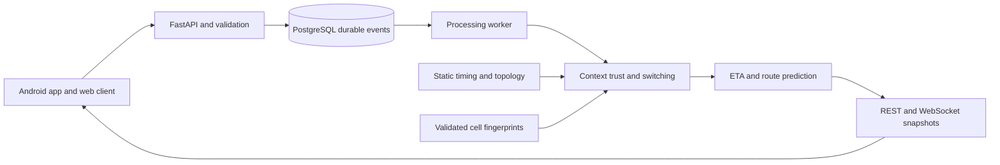

# FindMyMetro software only redesign

> **Implementation update:** This document is the original proposal. The [16 October implementation record](SOFTWARE_IMPLEMENTATION_2026-10-16.md) describes completed software changes and explicitly identifies the unfinished private-session and device-validation work.

Change specification and implementation roadmap

Version 2 design baseline     16 October 2026

FindMyMetro will replace its WSN based tracking dependency with a software approach using operator travel times, passenger journey sessions, crowd reports and consented phone observations. The target covers underground, surface and mixed journeys across the stored Delhi and Noida metro network.

### Decision and scope

The passenger keeps source to destination route search and suggestions for shortest time, fewer interchanges, less walking and shortest distance. A native Android client will provide direct access to available cellular observations. The web app remains a route planning and reporting interface, with browser location where permission allows.

No ESP32 controller, Hall or IR sensor, RFID, load sensor, custom station device, WSN gateway or MQTT broker is required by the revised application. Existing mobile operator infrastructure is an optional source observed by the phone; this project does not install or control it.

### Implementation status

| Item | Status as of this document |
| --- | --- |
| Existing application | Local React web app, FastAPI, PostgreSQL worker, operator catalogue and surface report workflow are present in the repository. |
| New software design | Specified here. Underground check ins, passenger sessions and cell assisted source selection require implementation. |
| Android cell support | Selected as part of the requested new scope. The current Android activity has no cell information collector. No new APK or device result is claimed. |

This documentation update defines the changes. It does not certify that the redesign has been implemented or tested. The earlier hardware based design and its recorded tests remain historical evidence for that version.

## 1 Complete change inventory

The following changes replace the acquisition and estimation assumptions while preserving the passenger journey planner and recoverable processing.

| ID | Previous design | Revised design |
| --- | --- | --- |
| C01 | WSN preferred underground | Operator segment timing with a passenger anchor, qualified check ins and optional cell support. |
| C02 | Physical sensors and MQTT | Remove from the active product, startup, credentials, APIs and documentation. |
| C03 | Surface only delay reports | Add explicitly labelled underground check ins and separate validation rules. |
| C04 | WSN exit snapshot | Persist the last accepted phone or passenger anchor and original event time. |
| C05 | Sensor versus crowd trust | Score location, station confirmation, mapped cell evidence and their agreement. |
| C06 | Train state used for tracking | Introduce private passenger journey sessions. Preserve operator train identity as a separate concept. |
| C07 | Earlier arrival focused mobile UI | Add native Android route choice, journey progress, permission controls and cell availability. |
| C08 | Hardware pending UI labels | Show static, observed, estimated, community reported, stale or unavailable status. |
| C09 | Existing prediction pipeline | Keep deterministic fallback. Train improved segment models only on independently labelled journeys. |
| C10 | Existing tests and presentation | Add phone and cell scenarios, update architecture, requirements, status records and viva explanation. |

### Safe removal boundary

Disable hardware ingestion before removing its runtime dependencies. Preserve old event history and migrations for recoverability. Archive obsolete hardware samples and old diagrams outside the active runtime, rather than deleting passenger data. New outputs must never wait for a sensor to connect.

## 2 Revised system architecture

One backend changes its accepted evidence path according to route context and data quality. Source switching does not start a different server.

The Android client uses Flutter and Dart for the passenger UI, with a Kotlin platform channel for cellular access. React and TypeScript remain the browser UI. Both send the same normalized event contract to FastAPI. HTTP handles requests and uploads. WebSocket publishes accepted route and journey snapshots.

Pydantic validates payloads. PostgreSQL stores events before acknowledgement. A worker applies validation, source selection and prediction rules inside transactions. SQLAlchemy and Alembic maintain persistence and schema changes. NetworkX compares valid route alternatives.

The new context router consumes passenger journey state and versioned station or segment zones. Its evidence engine receives location fixes, station check ins, community signals and a qualified cell match when available. Prediction combines accepted evidence with the static baseline and publishes source, freshness and uncertainty.

### Independent state domains

A passenger session represents one selected journey. A station service signal represents reported extra waiting at one boarding location. An operator trip represents a known scheduled train. The backend must not convert one domain into another without supporting association evidence.

## 3 Static data and prediction rules

### Timing source order

Use the dated DMRC or NMRC segment time already in the versioned catalogue. If an approved historical segment estimate is later available, store its provenance separately. A configurable 120 second segment fallback may support missing timing, but its label must say project assumption. It must not replace a known operator value or be described as a universal official DMRC rule. [W1, W2]

Two minutes is a proposed travel estimate per station interval. It is not the gap between consecutive trains. A static route duration alone cannot establish the next train arrival or ordinary boarding wait.

### Journey duration

Baseline ride duration = sum of the selected ride segment times. Total journey estimate = ride duration + configured walking and transfer time + applicable waiting estimates + qualified additional delay. Preserve the existing warning when ordinary boarding wait, access or security time is unavailable.

Record whether a supplied segment time already includes intermediate dwell. Add dwell only when the source contract excludes it. Apply a station extra wait once at the relevant boarding, not on every subsequent segment. Do not apply a station waiting report to the running time of an already boarded passenger.

### Onboard progress

After an explicit boarded or departed anchor, remaining nominal duration = max of zero and the leg baseline duration minus estimated progress on that leg. Correct the estimate only with a qualified later anchor. Elapsed time alone does not prove that a train moved, departed or reached a station.

### Illustrative calculation

S1 to S5 contains four intervals. Under the optional 120 second assumption, the ride baseline is 480 seconds, or 8 minutes. A separately reported 90 second extra boarding wait produces 9 minutes 30 seconds before walking or other known waits. These are example values, not a recorded Delhi Metro result.

### Uncertainty

Start with source labels and a heuristic quality score. Widen uncertainty as time since a trustworthy anchor grows. Publish a numerical confidence interval only after its coverage has been evaluated against held out journeys. Never turn a heuristic trust score into an accuracy percentage.

## 4 Underground journey behavior

Underground operation starts from known route context. GPS loss by itself must not classify a phone as underground. A road, building or disabled location service can produce the same symptom.

### Step by step flow

- The passenger selects a route, line and direction, then explicitly confirms boarding at a station. Persist a private session with the network version, current ride leg and timestamp.
- Load the operator timing profile for that leg. Advance an estimated progress indicator while keeping the last actual observation time unchanged.
- Offer explicit arrived, still at this station and departed actions when location is weak. A manual confirmation updates personal guidance with a self reported label.
- Evaluate available Android cell patterns only against a validated station fingerprint map. An unknown or ambiguous cell pattern does not create a station arrival.
- Validate underground community reports separately. A report without independent location evidence must retain its weaker evidence class and cannot obtain GPS verified status.
- If no useful observation arrives, retain a labelled static estimate, increase uncertainty and request a station confirmation. Never silently mark arrival or completion.
### Station and interchange protection

An arrived or still waiting check in pauses personal movement estimation until an explicit departure or qualified movement observation. Stop automatic progress at the end of a ride leg. Require the passenger to confirm the next boarding after an interchange; a timer must not imply that they completed a walk or boarded another line.

### Service report boundary

A passenger saying I am at this station can support their own journey. It does not prove that another passenger is on the same train. A new underground community wait signal requires agreement by station, exact line path, direction and observation window, with a clear self reported label.

## 5 Surface journey and crowd behavior

### Foreground phone observations

With explicit permission, match location fixes to the selected route and direction. Apply accuracy, route proximity, age and plausible movement checks before adjusting progress. Prefer operating system location over a weak cell match on a well observed surface section. Browser geolocation provides a location estimate, not raw cellular identifiers. [W5]

### Current rules to preserve

The existing station reporting flow requires account authentication, location accuracy at most 100 metres, station proximity at most 250 metres and observation age below 300 seconds. It requires three accounts agreeing within a 45 second observation span and a 60 second delay value span. Duplicate delivery adds no confirmation. These are software controls, not proof of distinct people. [L3]

### New report classes

| Class | Accepted use | Protection |
| --- | --- | --- |
| Location checked station wait | A qualified community boarding wait overlay. | Keep original event time and proximity checks. |
| Underground self report | Personal anchor or separately labelled corroborated station report. | Never claim GPS verification. Require stronger corroboration before public effects. |
| Onboard progress | Update a passenger session and derive a segment outcome if independently anchored. | Do not identify a train or alter every passenger journey from one phone. |

A proposed starting rule for unlocated underground service reports is five authenticated accounts with consistent recent sessions. This is a new configurable rule for validation, not an implemented threshold or proof of independence. Unsupported reports remain unconfirmed.

### Output behavior

Keep original timestamps during offline retry. Expire an accepted group when its first required member ages out. Invalidate cached effects at the same deadline. Route alternatives may change only from an applicable accepted delay or closure, and the result must show what changed.

## 6 Mixed routes and stable source switching

A route can contain several underground and surface sections. Preserve one journey identity and the accepted progress anchor while adapting the evidence path for each current leg.

| State | Main evidence | Fallback |
| --- | --- | --- |
| Surface observed | Qualified route matched phone location and applicable community reports. | Static timing with age and uncertainty. |
| Underground estimated | Static segment profile plus passenger anchors and qualified cell support. | Request a check in and retain an estimated label. |
| Transition evaluating | Saved anchor plus newly available observations compared in parallel. | End arbitration at its original deadline. |
| Awaiting boarding | Explicit confirmation for the next ride leg. | Show the route, without advancing movement. |

### Handover rules

At a configured boundary or credible route matched observation, save the last anchor, source quality, selected leg and original time. Start a persisted 60 second arbitration window. Compare incoming timestamps only when they refer to the same event and journey context. A 45 second tolerance is a starting rule for equivalent events, not permission to fuse unrelated phones.

Retain the normal controls of minimum trust 0.60, a quality advantage above 0.15, three distinct evaluations and a 30 second hold as initial settings to reevaluate. Allow recovery when the active source becomes unusable. Persist a reason for every switch. A cell hint alone must not override a recent contradictory qualified location.

At the deadline, accept qualified fresh evidence or return to the static estimate. The 60 seconds bounds arbitration and any observation based extrapolation. It does not end the passenger journey or falsely confirm another station.

### Conflicting information

Hold ambiguous observations for review and request a new anchor. Do not move progress backwards because an older upload arrived later. Do not jump across an interchange or switch line because a cell serves more than one location. Both underground to surface and surface to underground paths need independent tests.

## 7 Android cellular observation design

Direct cellular access belongs in the Android app now, as requested. Extend the existing Flutter and Dart project with a Kotlin MethodChannel adapter. The web client remains usable, but its cell capability must report unavailable. [L7, W5]

### Native adapter responsibilities

Use TelephonyManager cell information, with runtime precise location consent and a device capability check. Android documents that cached cell results can be old and updates can be rate limited or absent. Check measurement age, handle null data and reject unavailable identity fields. Reading a cell list is not a precise location measurement. [W3, W4]

Return a capability status, measurement age, radio technology, registered or serving status and a minimized fingerprint with signal measurements when available. Do not request carrier privileged network scans, IMSI, IMEI, phone numbers, call content or SMS. Treat tablets, permission denial, disabled location, no SIM, unsupported radio and empty modem results as normal fallback states.

### Sampling and consent

Start foreground collection only after the passenger starts tracking and grants consent. A 15 second request interval is an initial battery budget, not a guaranteed modem update rate. Pause when tracking stops or the app is no longer active. A background service, persistent notification or background location scope would require a separate design and consent review.

### Time and offline handling

Derive native sample age from the Android measurement timestamp and a monotonic device clock. Send observation time and receipt time separately. A delayed queued cell reading must not become fresh at upload. Queue size and retention stay bounded and account scoped.

### Local testing and delivery

A computer can test adapters with recorded fixtures and permission simulations. Real cell observations require a compatible Android phone, location permission and an available radio network. Produce and test an APK before calling Android support complete. Loopback on a phone is not the laptop: a local developer setup can use a controlled USB port reverse rather than exposing the database.

## 8 Cell fingerprints and underground inference

The proposed improvement combines a route constrained timing model with observed cellular patterns and independent station anchors. A cell identifier is a radio network identifier. It is not automatically a station identifier or a known tower coordinate.

### Build the map before trusting it

- Collect consented reference samples near independently established stations. Record network version, operator, radio technology, measurement age and the evidence supporting the station label.
- Use reviewed station labels. Personal timer predictions and earlier model outputs must never become their own training ground truth. Ordinary manual check ins alone remain weak labels.
- Separate mapping data from evaluation journeys. Cover different phones, carriers, directions and times. Require repeated independent support and reject patterns that also fit nearby stations.
- Version and expire mappings when supporting evidence ages, the catalogue changes or the operator changes radio configuration. An initial map is empty until actual reference evidence exists.
### Candidate selection

First constrain candidate stations to the selected line, direction and reachable adjacent route positions. Then compare the observed multi cell pattern with reference patterns, considering recency and signal variation. Require a clear margin over the second candidate and support from a route anchor or independent evidence. If no unique candidate survives, publish an ambiguity reason and retain the baseline.

Start with auditable rules and a candidate set. A Hidden Markov Model is a later candidate: station or segment states, ordered route transitions and cell observations can express uncertainty. Choose it only if held out field evaluation beats the rule based baseline. No model performance is claimed here.

### Why this remains supporting evidence

Shared or changing radio coverage, multiple possible locations and stale readings can defeat a unique station match. Treat this as a design constraint to test, not a promise that every underground station broadcasts a distinct observable cell. This project observes existing network service and installs no telecom equipment.

## 9 Data model and API contracts

| Record | Required purpose and fields |
| --- | --- |
| PassengerJourney | Owner, selected route, network version, ride leg, lifecycle, original start, last accepted anchor, estimated progress and optimistic version. |
| PhoneObservation | Event ID, owner, journey, type, observed and received times, location or minimized cell payload, sample age, outcome and reason. |
| CellReference | Versioned fingerprint, station candidates, evidence provenance, independent support, validity window and evaluation status. |
| StationServiceSignal | Station, line path, direction, report class, group members, delay, trust, first member expiry and confirmation status. |
| SourceDecision | Journey version, context, source candidates, selected source, reason, original deadline and output quality. |

These are proposed schema additions or explicit domain separations. Existing event, decision and prediction tables can be reused where their meanings match. Do not overload the operator Trip table to represent an arbitrary passenger session.

| Proposed interface | Purpose |
| --- | --- |
| GET /api/v1/capabilities | Software sources and Android cell capability expectations. |
| POST /api/v1/journeys | Start an owned session from a server validated route. |
| GET /api/v1/journeys/current | Resume the signed in passenger session. |
| POST /api/v1/journeys/{id}/observations | Idempotent location, station and cell observations. |
| POST /api/v1/journeys/{id}/advance or stop | Confirm next boarding or explicitly end tracking. |
| WS /ws/journey-progress/{id} | Owned versioned progress snapshots and accepted changes. |

Retain network, routes and service status endpoints. Generalize reports to /api/v1/service-reports/batch while keeping a temporary compatible surface route. Retire sensor ingestion and provisioning endpoints. These new interface names are contracts for implementation, not claims that they already exist.

## 10 Output and trust safeguards

### Prediction snapshot

Every snapshot should include journey ID and version, network version, selected leg, planned section context, selected source, source reason, last actual observation time, generated time and evidence expiry. Include estimated remaining time, arrival estimate kind, static timing provenance, any accepted extra wait and its scope. A timer tick may update an estimate without changing the observation timestamp.

### Passenger labels

| Label | Meaning |
| --- | --- |
| Static travel estimate | Uses operator timing or a clearly disclosed project fallback. |
| Estimated journey progress | Derived from an anchor and elapsed time. Station passage is unconfirmed. |
| Location checked | A phone fix passed route and accuracy checks. Train identity remains separate. |
| Cell assisted estimate | A qualified pattern supports the candidate route position. |
| Passenger confirmed | A personal station action, with self reported status retained. |
| Community reported delay | A qualifying group reports extra wait at a specific boarding point. |
| Saved or stale | Evidence has aged or the connection is unavailable. |

### Protection and data minimization

Preserve account authentication, scoped ownership, durable acknowledgement, rate limits and CSRF protection appropriate to each client. Browser sessions keep their existing cookie protections. The native client needs an explicitly reviewed session transport and logout behavior; never embed a privileged API key in the app.

Obtain separate consent for tracking and sharing cell reference samples. Do not expose another passenger path or raw cell trace through public status APIs. Minimize or pseudonymize radio identifiers and document retention. Hashing alone does not make location records anonymous. Deletion must remove owned phone observations and invalidate derived reference support when required.

The proposed default remains foreground tracking. A stopped session, revoked permission or expired account must stop collection and reject further private progress updates.

## 11 Implementation map and migration

The implementation should preserve current user accounts and catalogue data. The following file map makes the work reviewable against the existing repository.

| Existing area | Required change |
| --- | --- |
| backend/app/context_switching.py | Replace WSN source assumptions with software candidates and an explicit journey state machine. |
| backend/app/surface_reports.py | Generalize report classes and underground corroboration without weakening existing location checks. |
| backend/app/journey_planner.py | Keep route preferences. Apply scoped accepted delays once and return timing provenance. |
| backend/app/prediction.py and ml_prediction.py | Support anchored passenger estimates separately from operator trip predictions. Preserve fallback. |
| backend/app/main.py and worker.py | Register session and phone contracts, process new durable jobs and retire hardware ingestion. |
| backend/app/models.py and migrations | Add owned session and cell reference records with indexes, lifecycle and retention rules. |
| frontend/src | Replace sensor messages, add personal tracking, check ins and truthful capability or age labels. |
| mobile/lib and Android MainActivity.kt | Build route oriented Android UI and the Kotlin cellular adapter with permission handling. |
| hardware and MQTT runtime configuration | Remove active runtime assets and package dependencies after software tests replace their coverage. |
| README and project presentations | Update architecture, scope, thresholds, diagrams and evidence boundaries. |

### Migration and recovery

Back up the database and preserve the previous configuration. Add new tables before enabling new clients. Deploy compatible contracts, then switch the active source policy. Remove hardware startup, public sensor APIs and provisioning controls after verification. Keep historical schema support until an explicit data migration retires it. Never restore over a populated live database as a rollback shortcut.

## 12 Verification and completion gates

| Scenario | Required result |
| --- | --- |
| No location and no cell map | Routes work with labelled static timing. No invented station or live train. |
| Underground check in and stop | Arrival freezes personal progress. Departure is explicit. Estimates preserve age. |
| Mixed journey in both directions | State survives handover and restart. No movement across an unconfirmed interchange. |
| Old or ambiguous cell readings | No false station anchor, no confidence increase and a recorded fallback reason. |
| Surface loss and recovery | Plausible fresh location can restore observed guidance without a backward jump. |
| Duplicate and late uploads | One effect per event. Independent agreement and original times remain correct. |
| Expired service agreement | Delay expires from API, cache and both clients at the same boundary. |
| Ownership and consent | Other accounts cannot read sessions. Stop, logout and denial stop collection. |

### Evaluation protocol

Compare static timing alone, fixed source priority and the revised context router on identical held out journeys. Split by complete journey and time, avoiding future confirmations in earlier features. Measure ETA MAE and RMSE, station candidate error, wrong context switches, uninterrupted estimate availability, latency and battery cost. Include unmapped routes and carriers rather than evaluating only known fingerprints.

Initial targets from the earlier plan remain targets: REST p95 below 500 ms, connected updates below 30 seconds, ETA MAE below 90 seconds and RMSE below 120 seconds under documented conditions. Their suitability must be checked for the new phone based design. Do not present the old WSN or synthetic test outcomes as proof that the new design passes.

### Completion gate

Backend tests, web flows, Android permission and lifecycle tests, APK installation and real phone checks must pass before software support is declared complete. Useful underground cell mapping and field ETA claims require actual reference journeys and independent ground truth.

## 13 Delivery phases and project explanation

| Phase | Deliverable and exit condition |
| --- | --- |
| 1  Contracts and static baseline | Version the new contracts, label timing provenance and remove hardware dependency from the default application. Routes remain usable. |
| 2  Journey sessions | Implement owned anchors, progress estimates, stop and transfer confirmation. Restart and offline tests pass. |
| 3  Crowd generalization | Support location checked and weaker underground report classes with distinct corroboration and expiry. |
| 4  Android collection | Deliver the Kotlin channel and route oriented Android app. Permission denial and empty radio data work safely. |
| 5  Cell reference and switching | Collect independent reference samples, version the map and validate ambiguity handling before enabling cell assisted anchors. |
| 6  Evaluation and packaging | Replay identical journeys, evaluate field evidence, update documentation and provide local start plus Android test instructions. |

### What makes the improvement useful

The revised project does not require installing sensors along a railway. It preserves useful route planning when phone observations disappear and makes the reason for each estimate visible. Route constrained cell patterns can add supporting evidence where a validated map exists. Passenger confirmation gives a practical recovery mechanism when neither location nor cellular information resolves the station.

### Presentation ready explanation

Our main problem is that passengers need good route choices and understandable delay estimates when location quality changes between surface and underground sections. We use operator travel time as a baseline, validate crowd reports and preserve a passenger journey across source changes. The Android app can contribute consented cellular observations as supporting evidence, while the backend always falls back to a clearly labelled estimate.

The software stack remains FastAPI and Python, PostgreSQL, NetworkX and React for the web interface. Flutter and Dart with Kotlin provide Android access. Prophet and Random Forest remain optional candidates that must beat the strongest timing baseline on unseen real journeys. No Git push or public deployment is part of this documentation update.

## 14 Sources and decision record

Decision record: replace the hardware dependent project path with software inputs; retain all route preferences; use a native Android app for direct cell information; keep the web app; document the complete redesign. Date: 16 October 2026.

### Primary technical and operator references

[W1] DMRC passenger website and service status disclaimer. Operator timing is indicative. The site does not establish a universal 120 second interval for all stations. https://delhimetrorail.com/?lang=en

[W2] NMRC Journey Planner and Fares. Preserve operator specific journey information and indicative timing. https://www.nmrcnoida.com/Passenger-Information/Journey-Planner-and-Fares

[W3] Android TelephonyManager reference, especially getAllCellInfo and requestCellInfoUpdate. https://developer.android.com/reference/android/telephony/TelephonyManager

[W4] Android location permission guidance. https://developer.android.com/develop/sensors-and-location/location/permissions

[W5] W3C Geolocation specification. Browser location uses a high level position interface. https://www.w3.org/TR/geolocation/

### Reviewed local evidence

[L1] README.md and SOFTWARE_COMPLETE.md. Existing routes, scope, reporting, worker and local profiles.

[L2] backend/app/context_switching.py, prediction.py and journey_planner.py. Existing source assumptions and accepted output path.

[L3] backend/app/surface_reports.py. Current accuracy, proximity, agreement, age and expiry rules.

[L4] backend/app/models.py, main.py, worker.py, config.py and migrations. Durable records, adapters, configuration and processing.

[L5] frontend/src/SurfaceReportDialog.tsx, JourneyLiveStatus.tsx, App.tsx, api.ts and types.ts. Existing surface only UI and sensor messages.

[L6] VERIFICATION.md and IMPLEMENTATION_STATUS.md. Earlier local verification and outstanding integration gates.

[L7] mobile/pubspec.yaml, mobile/lib and mobile/android/app/src/main/kotlin/com/findmymetro/find_my_metro_mobile/MainActivity.kt. Existing Flutter project and Android entry point.

Local paths are relative to C:/Users/dell/Documents/ChatGPT/metro/find_my_metro. Web references were checked on 16 October 2026. All new entity names, endpoints, thresholds and phases in this document are proposed until implemented and verified.

